# plant.io

Aeroponic monitoring & control system with an electronic lab notebook. Designed to run on a Raspberry Pi alongside Node-RED, collecting telemetry from Phidget devices (and other I2C/GPIO/serial/Modbus sensors) via MQTT, with a modern React dashboard, automated image capture, S3 media storage, and structured grow tracking for ML dataset generation.

## Screenshots

| Dashboard & control | Automation & devices | Analysis & operations |
|---|---|---|
| 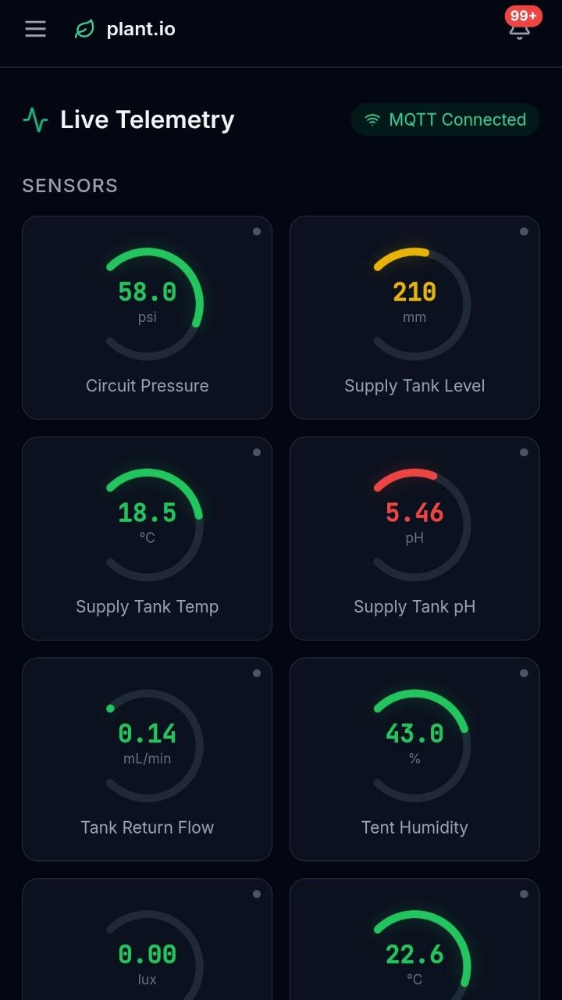 | 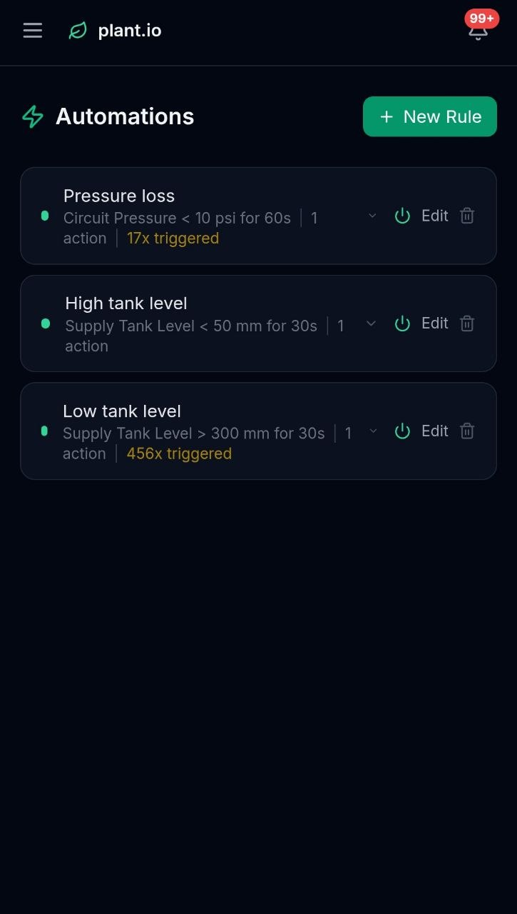 | 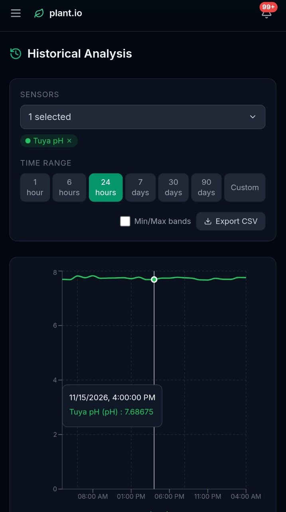 |
| 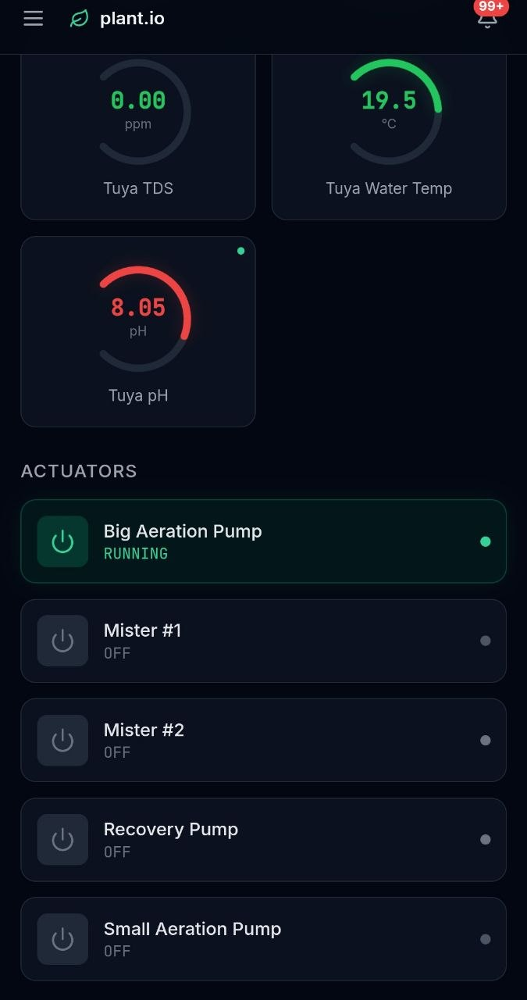 |  | 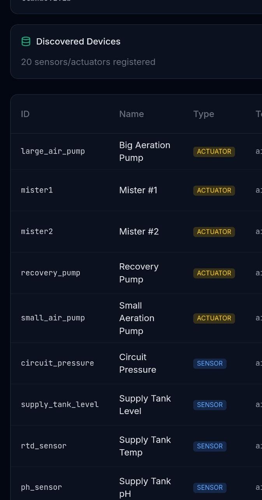 |
| 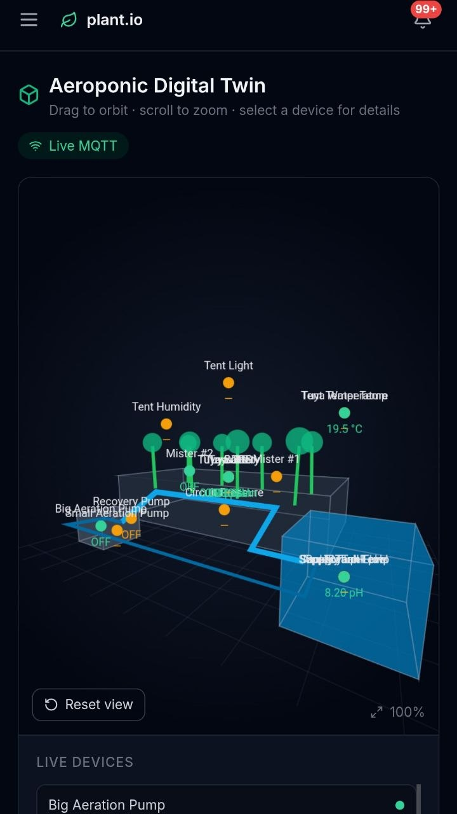 | 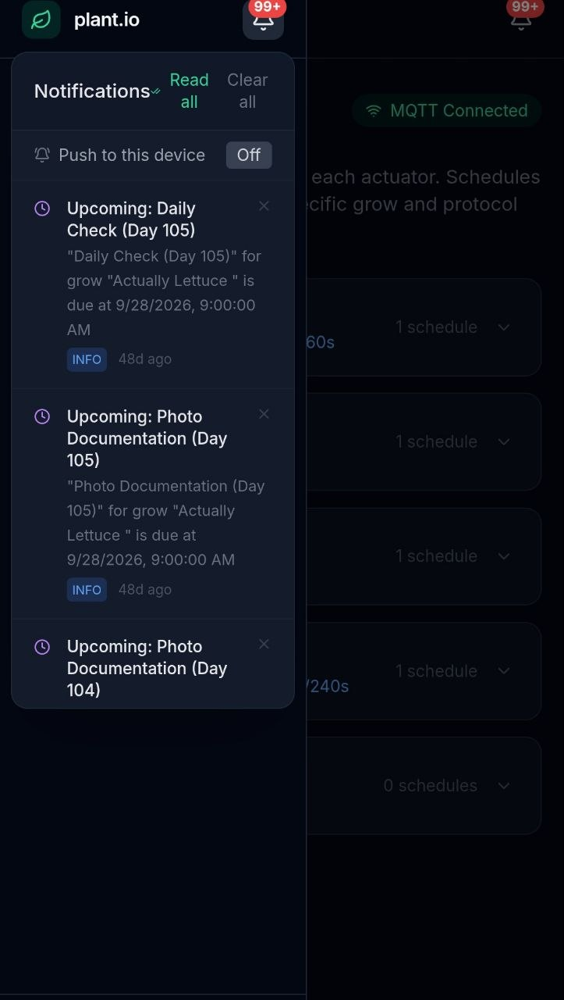 | 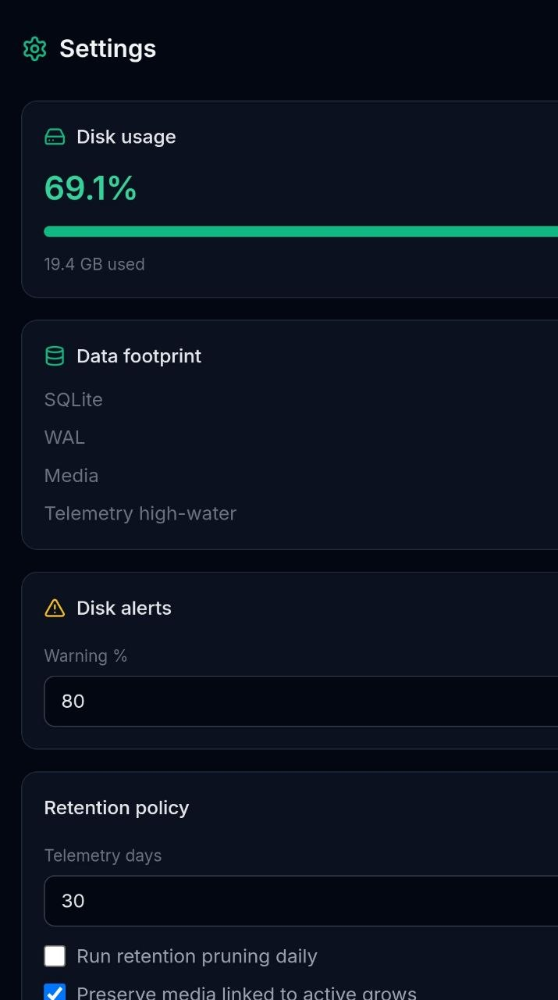 |
| 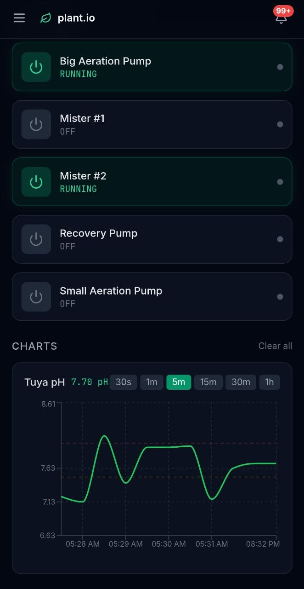 | | |

<details><summary>Grow management, AI & data</summary>

| Grow protocol | Grow AI assistant | Data export |
|---|---|---|
| 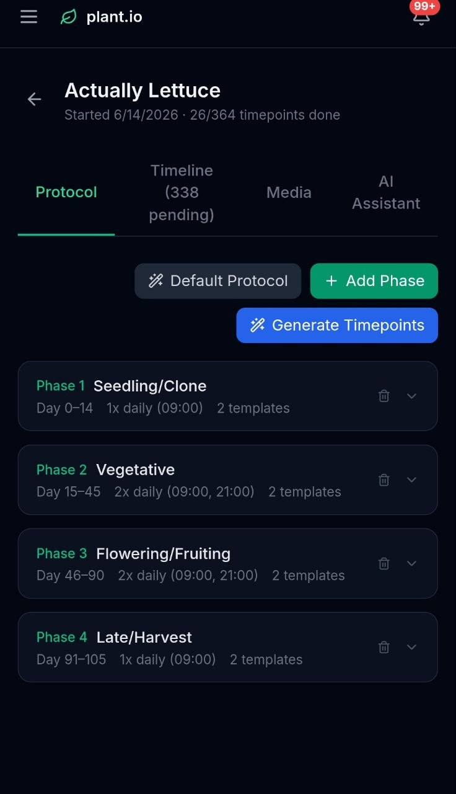 | 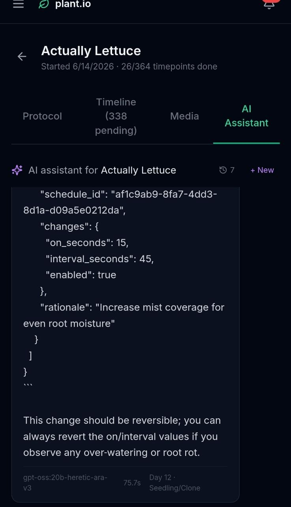 | 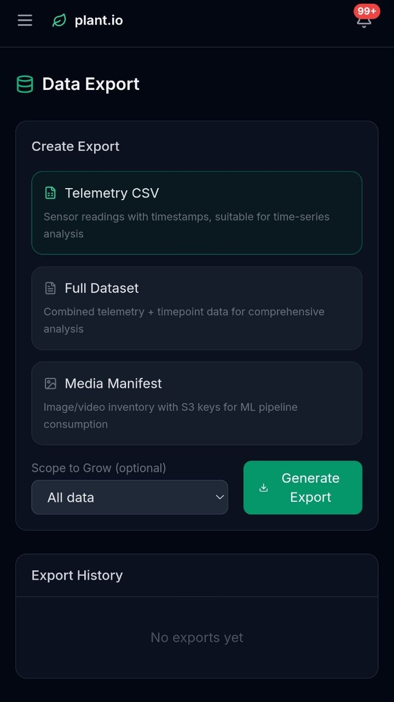 |

| Storage and AI/Ollama | Retention policy and maintenance | |
|---|---|---|
| 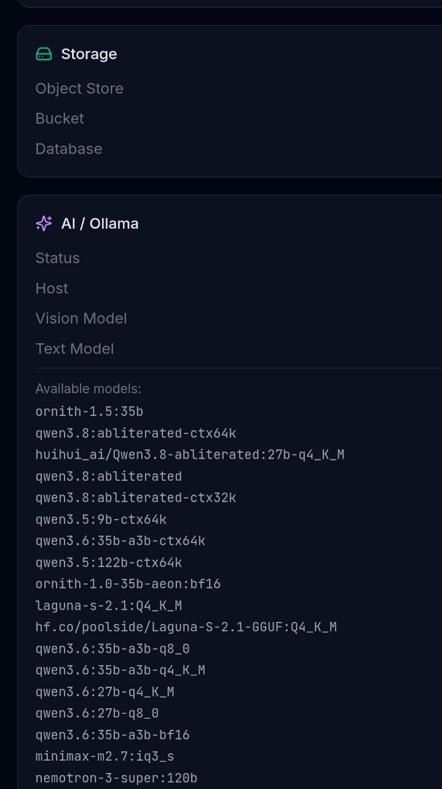 | 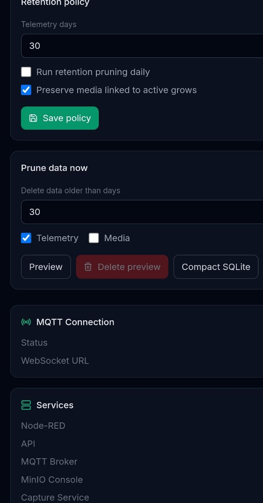 | |

</details>

## Architecture

```
┌───────────────┐     ┌──────────────┐     ┌──────────────┐
│   Phidget /    │────▶│   Node-RED   │────▶│  Mosquitto   │
│   Sensors      │     │  (pipelines) │     │ MQTT Broker  │
└───────────────┘     └──────────────┘     └──────┬───────┘
                                                   │
                         ┌─────────────────────────┼──────────────────┐
                         │                         │                  │
                         ▼                         ▼                  │
                  ┌──────────────┐         ┌──────────────┐           │
                  │ plant.io API │         │ plant.io Web │◀──────────┘
                  │ (Express +   │◀───REST──│  (React +   │  (WebSocket)
                  │  SQLite)     │         │   Tailwind)  │
                  └──────┬───────┘         └──────────────┘
                         │
              ┌──────────┼──────────┐
              ▼                     ▼
       ┌──────────────┐     ┌──────────────┐
       │    MinIO      │     │   Capture    │
       │  (S3 media)   │     │   Service    │
       │  :9000/:9090  │     │  (scheduled  │
       └──────────────┘     │   imaging)   │
                            └──────────────┘
```

### Services (Docker Compose)

| Service     | Port       | Description                                     |
|-------------|------------|-------------------------------------------------|
| `mosquitto` | 1883, 9001 | MQTT broker (+ WebSocket on 9001)               |
| `minio`     | 9000, 9090 | S3-compatible object store for images & exports  |
| `nodered`   | 1880       | Node-RED flow editor with Phidget22 nodes        |
| `api`       | 3001       | Express REST API + MQTT subscriber + SQLite      |
| `capture`   | —          | Scheduled image capture from USB/IP/RTSP cameras |
| `web`       | 3000       | React SPA (nginx in production)                  |

### Auto-Discovery

Node-RED publishes retained messages to `pio/discovery/<sensor_id>` containing sensor metadata (name, unit, type, gauge config, MQTT topic). The API subscribes and registers sensors automatically. The React frontend also subscribes via WebSocket -- new sensors appear in the dashboard without any code changes, similar to Home Assistant's MQTT discovery.

## Quick Start

### Prerequisites
- Docker & Docker Compose
- (On the Pi) Phidget libraries installed for Node-RED

### Run

```bash
docker compose up -d
```

Then open:
- **Dashboard**: http://localhost:3000
- **Node-RED**: http://localhost:1880
- **MinIO Console**: http://localhost:9090 (credentials from your `.env`)

### Development (without Docker)

```bash
# Terminal 1: API
cd api && npm install && npm run dev

# Terminal 2: Web
cd web && npm install && npm run dev

# Terminal 3: Capture service
cd capture && npm install && npm run dev

# You'll also need Mosquitto on :1883 and MinIO on :9000
```

## Features

### Real-Time Dashboard
- Auto-discovered sensor gauges with color-coded thresholds
- Actuator status tiles (relay states)
- Click any gauge to open a time-series chart
- Configurable time ranges (30m, 1h, 6h, 24h, 7d)
- Live MQTT WebSocket connection with reconnect

### Historical Analysis
- Multi-sensor overlay charts across arbitrary time ranges
- Preset ranges (1h → 90d) and custom date pickers
- Resolution auto-scales: minute → hour → day
- Min/max band visualization for aggregated data
- One-click CSV export from any view

### Automated Image Capture
- Configure USB webcams, IP cameras, RTSP streams, or MJPEG feeds
- Define per-camera capture schedules with configurable intervals
- Link capture schedules to specific grows for organized data collection
- Images stored directly in MinIO with structured path hierarchy
- Capture events published to MQTT for real-time notifications

### Lab Notebook (Grow Manager)
- Create and manage grows with strain, medium, start/end dates
- Define protocol phases (e.g., Germination → Vegetative → Flowering)
- Schedule timepoints: observations, measurements, tasks, feedings, harvests
- Record structured data at each timepoint (text, numbers with units)
- Attach photos/videos to any timepoint or grow
- Timeline view with completion tracking

### Data Export for ML Pipelines
- **Telemetry CSV**: Sensor readings with timestamps, filterable by sensor and time range
- **Full Dataset**: Combined telemetry + timepoint manual data in a single export
- **Media Manifest**: Complete inventory of all images with S3 keys, camera IDs, timestamps, and grow linkage -- ready for model training pipelines
- All exports stored in MinIO with presigned download URLs

### Data Pipeline
- Node-RED handles all hardware communication and data transformation
- Sensor readings published via MQTT with topic-based routing
- API persists all telemetry to SQLite with configurable resolution queries
- Analytics endpoints combine telemetry with grow timepoint and media data
- All media (manual uploads + auto-captures) stored in MinIO S3

## MQTT Topic Convention

```
airoponic/telemetry/<sensor_id>/<measurement>  # Sensor data
airoponic/command/<actuator_id>/set            # Control commands
pio/discovery/<device_id>                       # Auto-discovery configs
pio/status/<service>                            # Service health
pio/capture/<camera_id>                         # Capture events
```

## Adding New Sensors

1. Wire the sensor in Node-RED and create a flow that extracts the reading
2. Add an MQTT out node publishing to `airoponic/telemetry/<your_sensor>/value`
3. Add a discovery entry in the plant.io Discovery tab's function node
4. The dashboard auto-populates -- no frontend changes needed

## File Structure

```
├── docker-compose.yml
├── mosquitto/config/       # Mosquitto MQTT broker config
├── nodered/
│   ├── Dockerfile
│   └── flows.json          # Node-RED flows (Phidget + discovery)
├── api/
│   └── src/
│       ├── index.ts        # Express server + analytics
│       ├── database.ts     # SQLite schema (sensors, telemetry, grows, cameras, exports)
│       ├── mqtt.ts         # MQTT subscriber & telemetry ingestion
│       ├── s3.ts           # S3/MinIO client utilities
│       └── routes/         # REST endpoints (sensors, grows, media, cameras, exports)
├── capture/
│   └── src/
│       └── index.ts        # Scheduled image capture service
├── web/
│   └── src/
│       ├── components/     # React UI (Dashboard, History, Cameras, Exports, Lab Notebook)
│       ├── hooks/          # MQTT WebSocket + API client
│       ├── stores/         # Zustand state management
│       └── types/          # TypeScript interfaces
└── data/                   # Persistent volume (SQLite DB)
```
